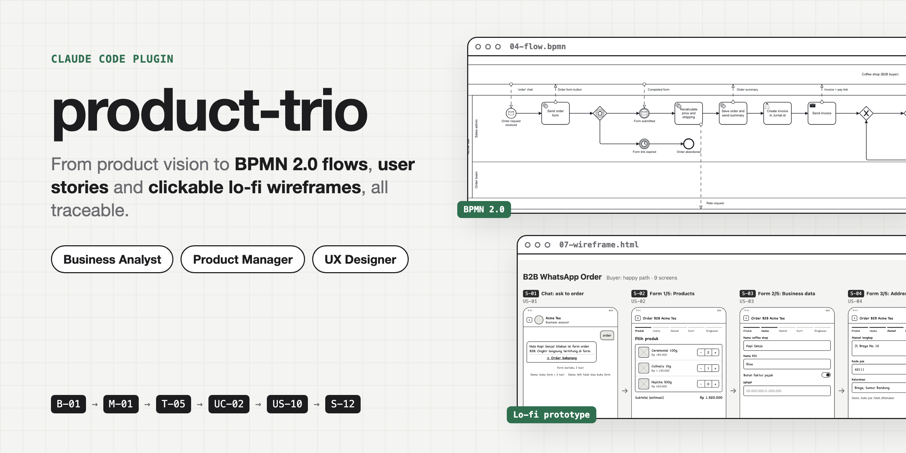
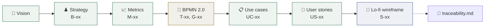
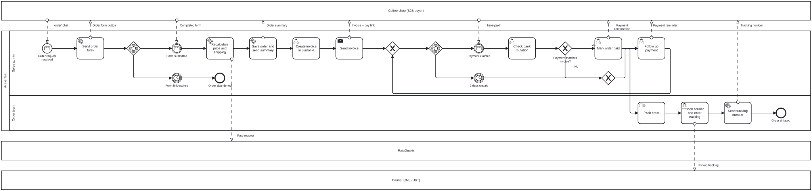
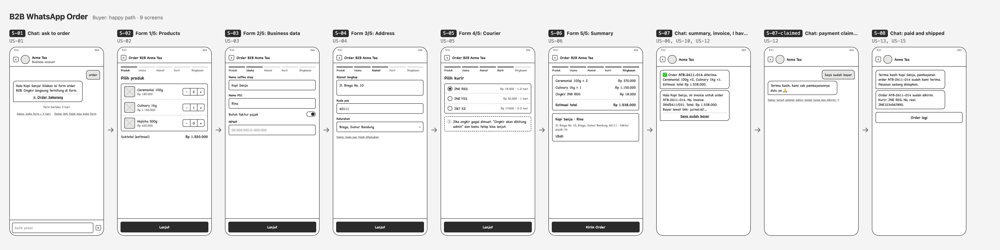
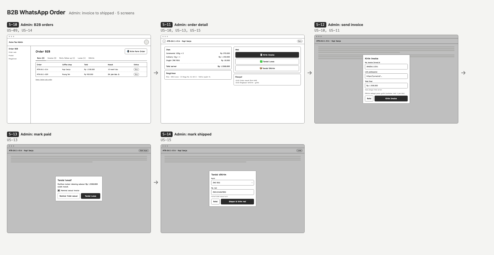
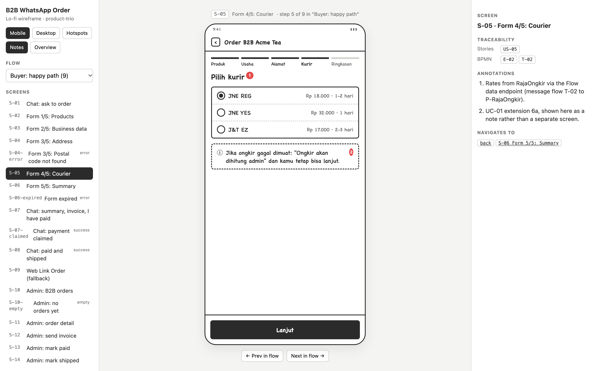
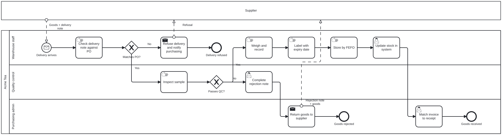
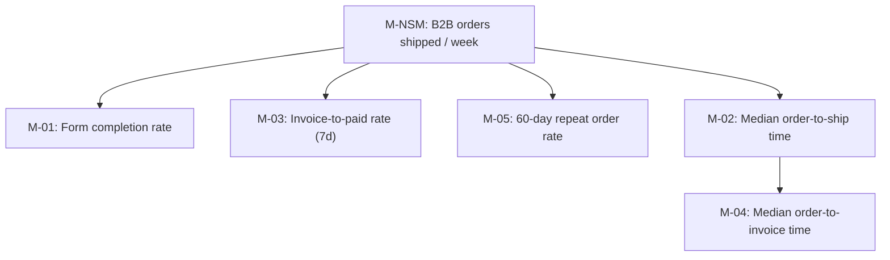
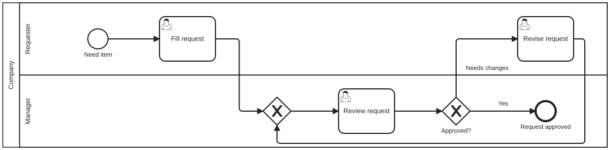

<p align="center">
  
</p>

<p align="center">
  
  
  
  
  <a href="LICENSE"></a>
</p>

**product-trio** gives Claude three product roles - **Business Analyst**, **Product Manager** and
**UX Designer** - and chains them into one discovery flow where every artifact carries IDs the
next one reuses. A BPMN task traces to a use case, a user story, a wireframe screen, a metric
and the strategic bet behind it.



## What you get

| Role | Skill | Output |
|---|---|---|
| Product Manager | `product-vision` | Vision statement, Moore elevator pitch, Pichler Vision Board, assumptions |
| Product Manager | `product-strategy` | Problem, JTBD, value proposition, falsifiable bets, non-goals, Now/Next/Later |
| Product Manager | `product-metrics` | North Star, metric tree, HEART/AARRR, metric dictionary, guardrails, events |
| Business Analyst | `bpmn-flow` | **Real BPMN 2.0 `.bpmn`** (Camunda Modeler, bpmn.io, draw.io) + validator + preview |
| Product Manager | `use-case` | Cockburn fully-dressed use cases with extensions and business rules |
| Product Manager | `user-story` | Epics, INVEST stories, Gherkin acceptance criteria, story map, MoSCoW, points |
| UX Designer | `lofi-wireframe` | Clickable grayscale prototype: flows, states, annotations, storyboard, mobile/desktop |
| Business Analyst | `sop-builder` | SOPs a new hire can follow: key-person risk register, activity table, BPMN swimlane flowchart, checklists and logs |

Plus **`/discovery <idea>`**, which runs the whole chain and writes a traceability matrix with a
coverage check.

## See it in action

Everything below was generated by a full `/discovery` run on a real feature: **coffee shops
ordering matcha wholesale through a WhatsApp Flow form**, invoiced in Jurnal.id and shipped with
JNE/J&T. Source: [`examples/b2b-wa-order/`](examples/b2b-wa-order/).

### 🔀 BPMN 2.0 process - Business Analyst



The customer is an external pool on top; message flows carry the form, invoice, payment claim and
tracking number. Event-based gateways model "first thing that happens" (form submitted vs. link
expired after 3 days; payment claimed vs. 2 days unpaid). The diagram is laid out by
[`bpmn_build.py`](plugins/product-trio/skills/bpmn-flow/scripts/bpmn_build.py) from a JSON spec,
after validation. Files: [`04-flow.bpmn`](examples/b2b-wa-order/04-flow.bpmn) ·
[`04-flow.json`](examples/b2b-wa-order/04-flow.json) · [`04-flow.md`](examples/b2b-wa-order/04-flow.md)

<details>
<summary>What the validator catches</summary>

```text
$ python3 bpmn_build.py 04-flow.json
ERROR   flow Flow_5 leaving exclusiveGateway G-01 needs a condition label (name) or default:true
ERROR   intermediateCatchEvent E-03 has no outgoing sequence flow (dead end)
ERROR   node E-10 is not reachable from any start event
WARNING task T-02 has 2 incoming flows (implicit merge); add an exclusive merge gateway before it

Validation failed: 3 error(s), 1 warning(s). Nothing written.
```

Also: start/end misuse, implicit splits, AND-split without AND-join, invalid event-based gateway
targets, message flows inside one pool, unnamed message flows, and lanes named after systems.
</details>

### 📱 Lo-fi wireframe - UX Designer

**Buyer journey** (WhatsApp chat + in-chat form), from the prototype's storyboard view:



**Admin journey** (desktop), invoice to shipped:



**The prototype itself**: flow selector, screen list, traceability panel (stories + BPMN nodes),
annotations, hotspots, mobile/desktop toggle and storyboard (`O`):



Every screen declares the stories and BPMN nodes it serves (`data-stories`, `data-bpmn`); every
use case extension gets its own state screen (error, empty, expired). File:
[`07-wireframe.html`](examples/b2b-wa-order/07-wireframe.html) (download and open locally).

### 📘 SOPs - Business Analyst

When the know-how lives in one person's head, `sop-builder` turns it into a procedure a new hire
can follow: it first ranks which SOPs to write by **key-person risk**, then writes each SOP as a
controlled document (purpose, scope, roles, step table with PIC, SLA and controls, exceptions,
records, KPIs, sign-off), with a BPMN swimlane flowchart and printable checklists and logs.



Every row of the step table names its BPMN node, so the document and the diagram cannot drift
apart. `sop_render.py` turns each SOP into one printable page (document, embedded flowchart, forms
as appendix pages; print or save as PDF). Example: [`SOP-WH-01 Receiving raw materials`](examples/sop-library/SOP-WH-01-receiving-raw-materials/sop.md) ·
[printable view](examples/sop-library/SOP-WH-01-receiving-raw-materials/sop.html) ·
[SOP register](examples/sop-library/README.md)

### 📋 Product Manager artifacts

<details>
<summary><b>Strategy</b> - falsifiable bets with signals</summary>

| ID | We believe that... | ...will result in... | We'll know when... |
|---|---|---|---|
| B-01 | an in-chat WhatsApp Flow order form with live shipping cost | most B2B orders arriving structured, with fewer drop-offs than chat | >= 70% of forms sent are submitted (M-01) |
| B-02 | admin actions that push invoice, paid and tracking messages automatically | zero lost orders and a shorter order-to-ship cycle | 0 dropped orders/month; median order-to-ship <= 2 days (M-02) |
| B-03 | cheapest-channel messaging (24h window first, template fallback) | WhatsApp cost per order staying near zero | messaging cost per order <= Rp 1,000 (G-01) |

Full file: [`02-strategy.md`](examples/b2b-wa-order/02-strategy.md)
</details>

<details>
<summary><b>Metrics</b> - North Star, tree and dictionary</summary>



| ID | Name | Formula | Target | Validates |
|---|---|---|---|---|
| M-01 | Form completion rate | order_form_submitted / order_form_sent (3d window) | >= 70% | B-01 |
| M-02 | Median order-to-ship time | median(shipped_at - created_at) | <= 48h | B-02 |
| G-01 | WhatsApp cost per shipped order (guardrail) | sum(est_cost) / shipped orders | <= Rp 1,000 | B-03 |

Full file: [`03-metrics.md`](examples/b2b-wa-order/03-metrics.md)
</details>

<details>
<summary><b>User story</b> - with Gherkin and traces</summary>

### US-10: Send invoice to the buyer
**As a** Sales admin **I want** to paste the Jurnal.id invoice number, link and total and send it
in one action **so that** the buyer can pay right away.

| Priority | Points | Release | Traces |
|---|---|---|---|
| Must | 5 | R1 | UC-02 steps 3-5, 3a, 4a; BPMN T-04, T-05; M-04; Screens S-11, S-12 |

```gherkin
Scenario: Send invoice
  Given an order with status "new"
  When Sales fills invoice number, link and total and taps "Kirim Invoice"
  Then the buyer receives the invoice with a "Saya sudah bayar" button
  And the order status becomes "invoiced"
  And event "invoice_sent" is tracked

Scenario: Sending fails
  Given the WhatsApp API returns an error
  When Sales taps "Kirim Invoice"
  Then an error is shown with "Coba lagi" and the status stays "new"
```

Full file: [`06-user-stories.md`](examples/b2b-wa-order/06-user-stories.md) (15 stories, story map)
</details>

<details>
<summary><b>Traceability</b> - one row per process step</summary>

| BPMN node | Use case (step) | User story | Screen(s) | Metric / event | Bet |
|---|---|---|---|---|---|
| T-01 Send order form | UC-01 (2, 2a) | US-01, US-11 | S-01 | M-01, G-01 / order_form_sent | B-01, B-03 |
| T-05 Send invoice | UC-02 (3-5, 3a, 4a) | US-10, US-11 | S-12, S-07 | M-03, M-04 / invoice_sent | B-02, B-03 |
| T-11 Send tracking number | UC-04 (4) | US-15 | S-14, S-08 | M-NSM / order_shipped | B-02 |

Plus a coverage check: tasks without use cases, extensions without stories, stories without
screens, bets without metrics. Full file: [`traceability.md`](examples/b2b-wa-order/traceability.md)
</details>

## Install

```bash
claude plugin marketplace add agungmahesa/ProductTrio
claude plugin install product-trio@product-trio
```

Inside Claude Code you can also use `/plugin marketplace add agungmahesa/ProductTrio` and
`/plugin install product-trio@product-trio`.

Requirements: Python 3.8+ (BPMN build script, standard library only). HTML previews load
`bpmn-js` from unpkg; the `.bpmn` file itself works offline.

## Use

```text
/discovery B2B reorder for cafe partners via WhatsApp
```

or call one skill directly: *"Model the as-is refund process in BPMN"*, *"Write user stories for
UC-02"*, *"Turn these stories into lo-fi wireframes"*. Outputs go to `docs/product/<feature-slug>/`:

```
01-vision.md   02-strategy.md   03-metrics.md
04-flow.json   04-flow.bpmn     04-flow.html   04-flow.md
05-use-cases.md                 06-user-stories.md
07-wireframe.md                 07-wireframe.html
traceability.md                 README.md
```

### BPMN build script

```bash
python3 plugins/product-trio/skills/bpmn-flow/scripts/bpmn_build.py examples/b2b-wa-order/04-flow.json
```

Writes `.bpmn` (BPMN 2.0 XML with diagram interchange) and an `.html` preview with zoom, `.bpmn`
download and SVG export. Spec format:
[`spec-format.md`](plugins/product-trio/skills/bpmn-flow/references/spec-format.md) ·
cheat sheet: [`bpmn-cheatsheet.md`](plugins/product-trio/skills/bpmn-flow/references/bpmn-cheatsheet.md)

### Wireframe template

[`wireframe.html`](plugins/product-trio/skills/lofi-wireframe/templates/wireframe.html) is a
self-contained prototype engine: screens are `<section>`s, `data-go` links them, `FLOWS` defines
journeys, and 30+ `wf-*` lo-fi building blocks cover the common UI.

| Key / URL | Does |
|---|---|
| `←` `→` | Step through the current flow |
| `O` or `?overview=1&flow=N` | Storyboard of every screen in a flow |
| `H` / `N` | Toggle hotspots / annotation markers |
| `?vp=desktop` · `#S-05` | Desktop frame · open a specific screen |

## Examples

| Example | Shows |
|---|---|
| [`examples/b2b-wa-order/`](examples/b2b-wa-order/) | Full `/discovery` run: vision -> wireframe + traceability |
| [`examples/sop-library/`](examples/sop-library/) | SOP register with key-person risk scores; SOP-WH-01 (English, modern layout) and SOP-GA-01 Kontrol Area (Bahasa Indonesia, classic corporate layout), each with BPMN flowchart and forms |
| [`examples/purchase-approval/`](examples/purchase-approval/) | Small BPMN with a rework loop |



To browse the HTML locally (bpmn-js needs http, not file://):

```bash
python3 -m http.server 8765
```

## Repository layout

```
.claude-plugin/marketplace.json        marketplace manifest
plugins/product-trio/
  .claude-plugin/plugin.json
  commands/discovery.md                /discovery
  skills/<skill>/SKILL.md              + scripts/, references/, templates/
examples/                              generated example outputs
docs/images/                           README visuals
tools/capture-previews.sh              regenerates docs/images with headless Chrome
```

After changing an example or the templates, refresh the README images with
`tools/capture-previews.sh`.

## License

[MIT](LICENSE) © 2026 Agung Mahesa Yudhistira. The example brand "Acme Tea" and all example data are fictional.
