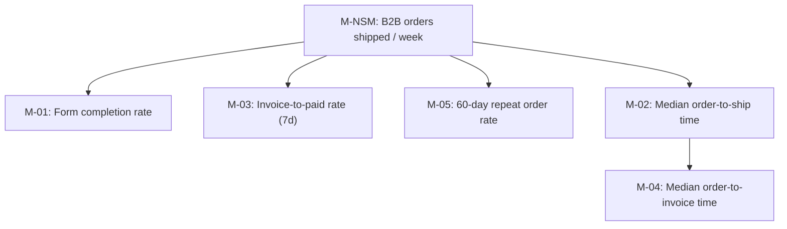

# B2B WhatsApp Order - Metrics
Status: Draft (example run) | Updated: 2026-11-05 | Links: 01-vision.md, 02-strategy.md

## North Star Metric
**M-NSM: B2B orders shipped per week** - one shipped order = one café restocked (user value) and is the revenue event for the B2B channel (business value). It is leading for repeat revenue and the team can move it through conversion and cycle time.

## Metric tree

## Framework: AARRR (adapted) - why: the feature is a conversion funnel from "order" request to shipped order, plus repeat.
| Category | Goal | Signal | Metric ID |
|---|---|---|---|
| Activation | Buyer completes an order in the form | form submitted after being sent | M-01 |
| Revenue | Invoiced orders get paid | payment claimed / marked paid within 7 days | M-03 |
| Retention | Cafés come back | second order within 60 days | M-05 |
| (Ops) Speed | Orders move without waiting on people | time between status timestamps | M-02, M-04 |

## Metric dictionary
| ID | Name | Definition | Formula | Data source / event | Granularity | Baseline | Target (date) | Validates |
|---|---|---|---|---|---|---|---|---|
| M-NSM | B2B orders shipped / week | Orders with channel `b2b_wa` reaching status shipped in the week | count(order_shipped) per ISO week | `orders.shipped_at`, `order_shipped` | weekly | TBD: count last 8 weeks from chat/invoices | +30% vs baseline (2027-02-28) | B-01, B-02 |
| M-01 | Form completion rate | Share of order forms sent that are submitted within 3 days | order_form_submitted / order_form_sent (same flow_token, 3d window) | `order_form_sent`, `order_form_submitted` | weekly | n/a (new) | >= 70% (2027-01-31) | B-01 |
| M-02 | Median order-to-ship time | Median hours from order created to shipped | median(shipped_at - created_at) | `orders` timestamps | weekly | TBD: sample 20 past orders | <= 48h (2027-01-31) | B-02 |
| M-03 | Invoice-to-paid rate (7d) | Share of invoiced orders marked paid within 7 days | order_paid(<=7d) / invoice_sent | `invoice_sent`, `order_paid` | weekly | TBD from Jurnal.id | >= 90% (2027-01-31) | B-02 |
| M-04 | Median order-to-invoice time | Median minutes from order created to invoice sent | median(invoice_sent_at - created_at) | `orders` timestamps | weekly | TBD | <= 2h in working hours (2027-01-31) | B-02 |
| M-05 | 60-day repeat order rate | Share of cafés with a shipped order that order again within 60 days | cafés with 2nd order <=60d / cafés with a shipped order | `orders` by customer phone | monthly | TBD | +10 pts (2027-04-30) | B-04 |

## Guardrails
| ID | Metric | Threshold | Why it matters |
|---|---|---|---|
| G-01 | WhatsApp cost per shipped order | <= Rp 1,000 | Core reason for dropping Wati (B-03) |
| G-02 | Dropped orders (created but no invoice after 24h, or paid but not shipped after 3 days) | 0 per month | The original pain |
| G-03 | Manual chat messages per order (sampled) | not higher than today | Automation must not add work |

## Instrumentation plan
| Event name | Trigger | Properties | Feeds metric |
|---|---|---|---|
| order_form_sent | Server sends Flow button (T-01) | phone, source (chat/admin), message_type | M-01 |
| order_form_submitted | Flow completes (E-02) | order_id, item_count, subtotal, courier, shipping_cost | M-01 |
| order_created | Order saved (T-03) | order_id, channel=b2b_wa | M-02, M-04, M-NSM |
| invoice_sent | Admin sends invoice (T-05) | order_id, invoice_number, total, message_type | M-03, M-04 |
| payment_claimed | Buyer taps "Saya sudah bayar" (E-04) | order_id | M-03 |
| order_paid | Admin marks paid (T-08) | order_id, hours_since_invoice | M-03 |
| order_shipped | Tracking sent (T-11) | order_id, courier, tracking_number | M-NSM, M-02 |
| wa_message_sent | Any outbound message | order_id, kind, message_type (service/template), est_cost | G-01 |

## Review cadence
Weekly (Monday) sales + order team review: NSM, M-01..M-04, G-01, G-02 from the admin dashboard. Monthly: M-05 and roadmap check against bets.
