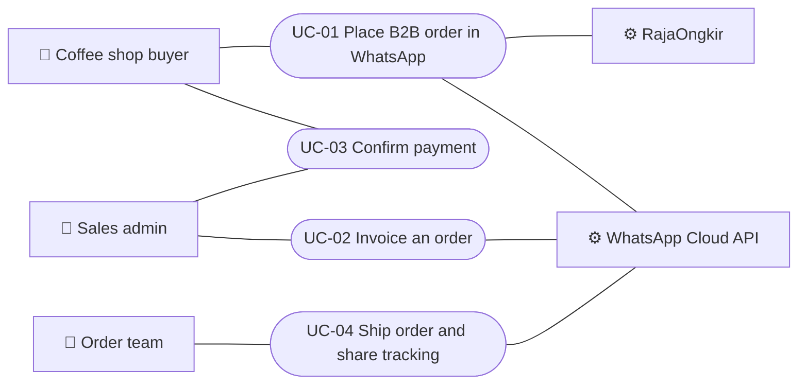

# B2B WhatsApp Order - Use Cases
Status: Draft (example run) | Updated: 2026-11-05 | Links: 04-flow.bpmn

## Actors
| ID | Actor | Type | Goals |
|---|---|---|---|
| ACT-Buyer | Coffee shop buyer | primary | Place an order; pay; know when it ships |
| ACT-Sales | Sales admin | primary | Invoice orders; confirm payment |
| ACT-Order | Order team | primary | Ship paid orders |
| ACT-RajaOngkir | Shipping rate API | supporting | - |
| ACT-WhatsApp | WhatsApp Cloud API | supporting | - |
| ACT-Jurnal | Jurnal.id / Mekari Pay | offstage | - |

## Use case diagram

## UC-01: Place B2B order in WhatsApp
| Field | Value |
|---|---|
| Primary actor | ACT-Buyer |
| Supporting actors | ACT-WhatsApp, ACT-RajaOngkir |
| Scope / Level | Acme Tea B2B order system / User goal |
| Stakeholders & interests | Buyer: fast, correct total. Sales: complete data, no re-typing. Finance: correct tax data. |
| Preconditions | Buyer has a WhatsApp chat with the Acme Tea number. |
| Trigger | Buyer types "order" (or Sales sends the form). |
| Minimal guarantee | No order is saved without a valid shipping quote; buyer is told what to do next. |
| Success guarantee | Order `ATB-...` saved with channel `b2b_wa`; summary in chat; admin notified. |
| Covers BPMN | E-01, T-01, G-01, E-02, E-03, T-02, T-03 |
| Related metrics | M-01, M-NSM |

**Main success scenario**
1. Buyer asks to order in the chat.
2. System replies with an "Order Sekarang" form button.
3. Buyer selects products and quantities.
4. Buyer enters business data (café name, PIC, tax invoice yes/no).
5. Buyer enters address and postal code; System lists subdistricts.
6. System shows courier options with shipping cost; Buyer picks one.
7. Buyer reviews the summary and submits.
8. System recalculates the total, saves the order, sends the summary to the chat and notifies the admin.

**Extensions**
- 2a. Buyer last messaged more than 24h ago (Sales-initiated): System sends the paid form template instead (BR-01).
- 2b. Buyer's WhatsApp cannot open Flows: System sends the web Link Order `acmetea.example/b2b`; use case continues at step 3 on the web.
- 5a. Postal code not found: System shows an inline error and lets the Buyer search the subdistrict by name.
- 6a. Shipping rates unavailable: System shows "Ongkir dihitung admin" and continues; admin is flagged.
- 7a. Form link older than 3 days: System shows "Form kedaluwarsa, ketik *order* lagi"; use case ends in failure (E-09).
- *a. Buyer closes the form: nothing is saved; the button stays valid until expiry.

**Business rules:** BR-01, BR-02, BR-03, BR-04

## UC-02: Invoice an order
| Field | Value |
|---|---|
| Primary actor | ACT-Sales |
| Supporting actors | ACT-WhatsApp, ACT-Jurnal |
| Scope / Level | Admin panel / User goal |
| Preconditions | Order exists with status `new`. |
| Trigger | Admin notification of a new B2B order. |
| Minimal guarantee | Order status unchanged if sending fails. |
| Success guarantee | Invoice number, link and final total stored; buyer receives invoice with "Saya sudah bayar" button; status `invoiced`. |
| Covers BPMN | T-04, T-05 |
| Related metrics | M-04, M-03 |

**Main success scenario**
1. Sales opens the B2B order list and selects the new order.
2. Sales creates the invoice in Jurnal.id (outside the system).
3. Sales taps "Kirim Invoice" and pastes invoice number, link and final total.
4. System sends the invoice to the buyer through the cheapest channel.
5. System marks the order `invoiced` and records the time.

**Extensions**
- 3a. Final total differs from the estimate: System shows the difference and asks to confirm.
- 4a. WhatsApp send fails: System shows the error, keeps status `new`, offers "Coba lagi".
- 4b. No WA credentials (test mode): System logs the message only and shows "Mode uji".

**Business rules:** BR-01, BR-04

## UC-03: Confirm payment
| Field | Value |
|---|---|
| Primary actor | ACT-Sales (with ACT-Buyer) |
| Scope / Level | Admin panel + WhatsApp / User goal |
| Preconditions | Order status `invoiced`. |
| Trigger | Buyer taps "Saya sudah bayar", or 2 days pass. |
| Success guarantee | Status `paid`; buyer confirmation sent; Order team notified. |
| Covers BPMN | G-02, G-03, E-04, E-05, T-06, G-04, T-07, T-08 |
| Related metrics | M-03 |

**Main success scenario**
1. Buyer pays the invoice and taps "Saya sudah bayar".
2. System alerts Sales "cek mutasi" and shows the order as "Klaim bayar".
3. Sales checks the bank mutation.
4. Sales taps "Tandai Lunas".
5. System confirms payment to the buyer and notifies the Order team.

**Extensions**
- 1a. Buyer has not paid after 2 days: System lists the order under "Perlu follow up"; Sales sends a reminder; use case resumes at step 1.
- 3a. Amount does not match the invoice: Sales sends a follow-up message; use case resumes at step 1.

**Business rules:** BR-01, BR-05

## UC-04: Ship order and share tracking
| Field | Value |
|---|---|
| Primary actor | ACT-Order |
| Scope / Level | Admin panel / User goal |
| Preconditions | Order status `paid`. |
| Trigger | Order team notification. |
| Success guarantee | Status `shipped`, tracking stored and sent to the buyer. |
| Covers BPMN | T-09, T-10, T-11, E-10 |
| Related metrics | M-NSM, M-02 |

**Main success scenario**
1. Order team packs the order.
2. Order team books the courier pickup.
3. Order team taps "Tandai Dikirim" and enters the courier and tracking number.
4. System sends the tracking number to the buyer and marks the order `shipped`.

**Extensions**
- 3a. Tracking number format invalid for the courier: System shows an inline error.

## Business rules
| ID | Rule | Source |
|---|---|---|
| BR-01 | Free service message inside 24h window, else paid utility template; summary only if free. | Feature brief |
| BR-02 | flow_token signed with buyer phone, valid 3 days. | Feature brief |
| BR-03 | Price and shipping recalculated on the server. | Feature brief |
| BR-04 | Tax invoice only on request. | Form field |
| BR-05 | Paid only when amount equals invoice total. | Finance |
