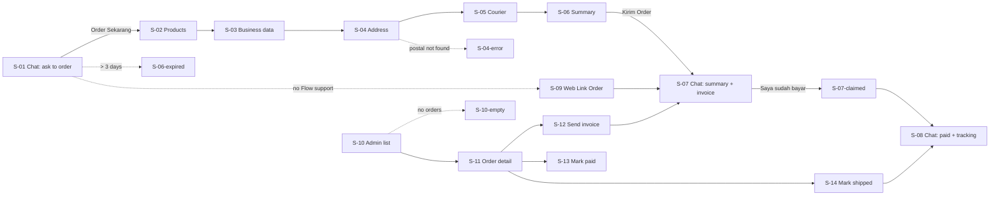

# B2B WhatsApp Order - Lo-fi Wireframe
Status: Draft (example run) | Updated: 2026-11-05 | Prototype: 07-wireframe.html

## Flow map

## Screens
| Screen | Purpose | Stories | BPMN | Primary action | Exits to |
|---|---|---|---|---|---|
| S-01 | Buyer asks to order, gets Flow button | US-01 | E-01, T-01 | Order Sekarang | S-02, S-06-expired, S-09 |
| S-02 | Pick products | US-02 | E-02 | Lanjut | S-03 |
| S-03 | Business data + tax invoice | US-03 | E-02 | Lanjut | S-04 |
| S-04 | Address + postal lookup | US-04 | E-02 | Lanjut | S-05, S-04-error |
| S-04-error | Postal code not found | US-04 | E-02 | Pilih kelurahan | S-04 |
| S-05 | Courier with live cost | US-05 | E-02, T-02 | Lanjut | S-06 |
| S-06 | Review and submit | US-06 | T-02, T-03 | Kirim Order | S-07 |
| S-06-expired | Form older than 3 days | US-07 | E-03, E-09 | Kembali ke chat | S-01 |
| S-07 | Summary + invoice in chat | US-06, US-10, US-12 | T-03, T-05, E-04 | Saya sudah bayar | S-07-claimed |
| S-07-claimed | Payment claim acknowledged | US-12 | E-04 | - | S-08 |
| S-08 | Paid + tracking in chat | US-13, US-15 | T-08, T-11, E-10 | Order lagi | S-01 |
| S-09 | Web Link Order fallback | US-08 | E-02 | Kirim Order | S-07 |
| S-10 | Admin B2B order list | US-09, US-14 | T-04, G-02 | Open order | S-11, S-10-empty |
| S-10-empty | No orders yet | US-09 | - | Kirim Form Order | S-10 |
| S-11 | Order detail + actions | US-10, US-13, US-15 | T-04..T-10 | Status action | S-10, S-12, S-13, S-14 |
| S-12 | Send invoice modal | US-10, US-11 | T-04, T-05 | Kirim Invoice | S-11, S-07 |
| S-13 | Mark paid modal | US-13 | T-06, G-04, T-08 | Tandai Lunas | S-11 |
| S-14 | Mark shipped modal | US-15 | T-10, T-11 | Simpan & kirim resi | S-11, S-08 |

## Open UX questions
- Can the Flow prefill business data and address from the last order (B-04, Later)?
- Should "Tandai Lunas" require an amount field instead of a checkbox to enforce BR-05?
- Test the 5-step form with 3 cafés before publishing the Flow (published Flows cannot be edited).
