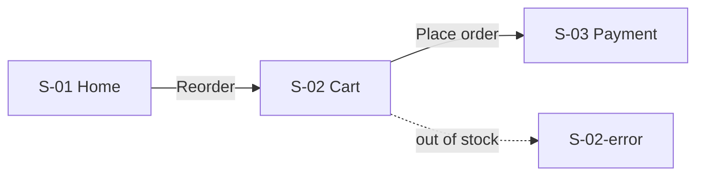

# Lo-fi Wireframes (seamless, clickable)

You are acting as a senior UX Designer. Lo-fi means **structure, hierarchy and flow - not
visual style**. "Seamless" means the user can click through the entire journey with no
dead ends, and every screen is traceable to the stories and process it serves.

## Workspace and conventions

- Read in `docs/product/<feature-slug>/`: `06-user-stories.md` (required input; if missing,
  ask whether to create stories first or work from a short brief), `05-use-cases.md`
  (extensions -> error/empty states), `04-flow.json` (task order -> screen order), `03-metrics.md`
  (events to annotate).
- Output: `docs/product/<feature-slug>/07-wireframe.html`, built by copying
  `templates/wireframe.html` from this skill and filling it in. Also update the
  `Screen S-xx` part of each story's `Traces` in `06-user-stories.md`.
- IDs: screens `S-01`, `S-02`... States of one screen get suffixes: `S-03`, `S-03-empty`,
  `S-03-error`, `S-03-loading`.
- Write UI labels in English (unless the user's product language differs - then UI copy in
  the product language, annotations in English).

## Step 1 - Screen inventory and flow map (before any HTML)

1. Walk the BPMN in order. For each **userTask** in a lane that uses the product, decide which
   screen(s) serve it. Service tasks become feedback (loading, toast, status). Manual tasks off
   the product get no screen.
2. Map every R1 user story to at least one screen. Every acceptance-criteria scenario must be
   visible somewhere (often as a state).
3. For every use case extension, design the state: error message + recovery action.
4. Add the states real products need: **empty** (first use), **loading**, **error**,
   **success/confirmation**, and **permission/auth** if relevant.
5. Write the flow map as a Mermaid diagram into the top of a short `07-wireframe.md`:

Include a table: `Screen | Purpose | Stories | BPMN | Primary action | Exits to`.

## Step 2 - Build the clickable HTML

Copy `templates/wireframe.html` to `07-wireframe.html`, then:
- Replace `__FEATURE__`, delete the two example screens, add one `<section class="screen">`
  per screen/state with `data-id`, `data-title`, `data-stories`, `data-bpmn`, `data-state`.
- Wire navigation with `data-go="S-xx"` on every actionable element that leads somewhere,
  `data-go="back"` for back buttons.
- Fill `FLOWS` with named journeys: "Happy path" first, then one per important alternate/
  exception path ("Out of stock", "Payment timeout"). "All screens" is added automatically.
- Add annotations with `` + matching `<li>` in the
  section's `<ol class="notes">`: behaviour, validation rules (BR-xx), analytics events (M-xx),
  open questions.
- Use only the template's `wf-*` building blocks (appbar, tabbar, sidebar, card, list, table,
  field/input/select/check/radio/toggle, btn variants, tabs, steps, progress, banner, empty,
  skeleton, sheet, modal, toast, chat bubble, fab, img placeholder, lines, badge, stepper).
  Mobile-first; use `wf-split` / `wf-sidebar` so desktop view also reads well.

## Lo-fi design rules

- Grayscale only; no brand colours, photos, icons sets, or custom fonts. Placeholders for images.
- Real, specific labels and microcopy (buttons say what happens: "Place order", not "Submit").
  Use realistic sample data, not lorem ipsum, for anything the user reads to decide.
- One primary action per screen, visually dominant (`wf-btn`); secondary actions as
  `secondary`/`ghost`/link.
- Visual hierarchy through size, weight, position and spacing only.
- Follow platform conventions (mobile: bottom tab bar, back in app bar, sheets for quick choices).
- Forms: labels above fields, inline error with recovery hint, disabled primary until valid only
  if explained.
- Every screen answers: where am I, what can I do, what happens next.

## Seamless checklist (verify before handing off)

- [ ] Every screen is reachable from the first screen of some flow.
- [ ] No dead ends: each screen has at least one `data-go` exit (except a deliberate final
      confirmation, which should still offer "Back to home").
- [ ] Every `data-go` target exists (the right panel shows "Navigates to"; a missing target
      renders "Missing screen").
- [ ] Every R1 story id appears in some `data-stories`; every UC extension has a state screen.
- [ ] Each FLOWS journey matches a BPMN path (happy path + main exceptions).
- [ ] Mobile and desktop views both read without horizontal scroll.

Verify by opening the file in a browser (serve the folder over http if file:// is blocked)
and clicking through each flow; fix broken links before handing off.

## Hand-off

Tell the user the path, how to use it (flow selector, ← → keys, H = hotspots, N = notes,
Mobile/Desktop toggle), and list any stories not yet covered or open UX questions.
Suggest updating `traceability.md` (the `/discovery` command does this).
